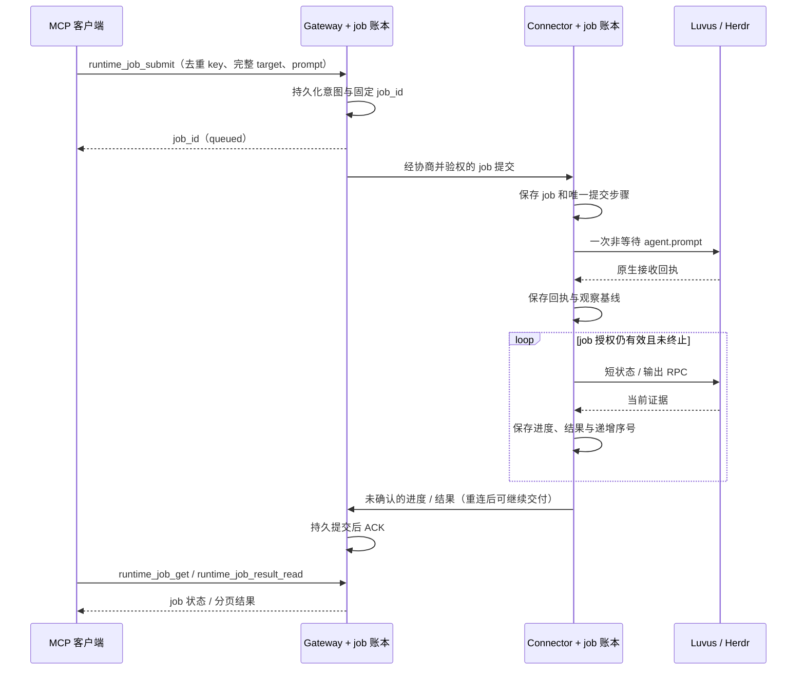

# ADR 0009：Luvus 与 Herdr 的持久 Agent 对话 job

状态：提议，尚未实现。本文中的 `runtime_job_*`、Wire job 消息、配置和能力名均为拟定接口，不能用于当前版本。

## 范围与现状

首期覆盖已经运行的 Agent 对话：提交一条 prompt，独立观察状态与终端输出，之后查询 job 或读取已保存的结果。Luvus 与 Herdr 共用 job 生命周期和 MCP 接口，各自适配原生参数、身份与证据。不把任意 native RPC 放到后台，也不在首期启动或恢复 Agent、自动回答 blocked 提问、重发 prompt 或结束 Agent 进程。

当前 `runtime_call` 的 `wait_ms` 缺省为 0，本来就会立即返回 `call_id`，调用可以并发提交。Connector 的普通执行并发缺省为 8；长 `agent.wait` 或带等待的 `agent.prompt` 会持续占用其中一个槽。抬高 RPC 超时只能延长这一占用，不能提供 job 的持久恢复语义。

当前结果也不是持久 job 结果：读取需要原 Wire 上下文，断连后不能在新 epoch 重建原许可。参见 [ADR 0006](0006-result-context-lifecycle.md)。新增 job 必须设计独立、显式授权的执行与结果生命周期；既有 `runtime_call`、结果句柄、TTL 和撤权规则保持原语义。

## 决策

Gateway 保存 job 意图、归属、去重与交付账本；Connector 保存提交步骤、观察进度和待交付结果，在本机运行有界的观察器。MCP 请求结束不停止 job，等待中的 job 不保有普通 native RPC 执行槽。每次观察只在发出短 RPC 时占用资源，由共享调度器公平限流。

不能仅把观察器放在 Gateway：Gateway 与设备断开时无法取得本机完成证据或保存输出。也不能把原 Wire permit 序列化后复用：它的真实来源和 epoch 已经失效。Connector 的 job 执行必须使用新的、由双方验证的有限 job 授权，不能伪造活跃连接。



job 不是一个一直驻留的 Promise，也不是新的无上限并发池。首期采用每 caller 8 个、每 Connector 32 个活跃 job 的上限；到达上限明确返回 `busy`。普通 RPC 与 job 短 RPC 共用 Connector 的实际总并发预算，job 同时在途的短 RPC 另限为 2，并为普通调用保留调度机会。默认观察间隔 2 秒，连续无变化时退避，重连加入抖动；客户端高频 `get` 不加速本机轮询。

## 拟定的 MCP 接口

继续通过完整 `target` 选择 provider，不新增 `luvus_job_*` 或 `herdr_job_*`。以下均为设计接口，尚不属于工具目录。

| 工具 | 参数与行为 |
|---|---|
| `runtime_job_submit` | `target`、`expected_binding_revision`、`contract_ref`、`client_request_key`、`agent_target`、`text`、绝对 `deadline`；先落盘再立即返回 job，首期固定 `kind: agent_conversation` |
| `runtime_job_get` | `job_id`；仅查询，返回提交、运行、观察连接、完成证据和结果状态，无隐式 native 调用 |
| `runtime_job_list` | 按当前 caller 可见 job 分页；签名游标绑定 caller、筛选、页大小和固定期限 |
| `runtime_job_cancel` | `job_id`；停止未开始的提交或后续观察，不代表 Agent 已停，不发送 Ctrl-C、退出命令或撤销 prompt |
| `runtime_job_result_read` | `job_id`、签名游标、`max_bytes`；读取独立授权、已持久保存且未过期的结果，不能用于普通 call 结果 |

`agent_target` 是明确选中的原生 Agent selector。接收 job 后必须解析、锁定 canonical pane / terminal / Agent session 身份；不能把 alias 当持久身份，不能在重连后重新挑一个同名 Agent。

`client_request_key` 必填，按 caller 去重。同 key、同完整意图返回同一个 job；同 key 改 text、target、deadline 或契约返回 `conflict`。请求超时后用同 key 查询既有意图，不能用新 key 重试提交。超过去重保留期的客户端也不得把旧意图当作未执行重发。

调用方显式提供 job deadline，建议 30 分钟，最大 2 小时，取双方配置上限；这是新增 job 生命周期，不修改普通 call 的十分钟上限。短 RPC 各自使用不超过 5 秒且不晚于 job deadline / 授权期限的 deadline。job deadline 只停止后续 job 工作，不承诺终止原生模型或命令。

### 公开状态必须分层

不能用一个 `completed` 同时表示“输入排队”“Agent 空闲”“已取得模型答案”。拟定 DTO：

```json
{
  "job_id": "job_example",
  "state": "observing",
  "submission": "acknowledged",
  "observation": "connected",
  "agent_status": "working",
  "completion": {
    "status": "unverified",
    "scope": "agent_state",
    "evidence": null
  },
  "result": {
    "status": "pending",
    "representation": "terminal_snapshot"
  }
}
```

| 字段 | 拟定值与含义 |
|---|---|
| `state` | `queued`、`preparing`、`submitting`、`observing`、`needs_attention`、`finished`、`submission_unknown`、`failed`、`cancelled`、`timed_out` |
| `submission` | `not_started`、`not_dispatched`、`acknowledged`、`unknown`；acknowledged 只承诺取得原生入队回执 |
| `observation` | `connected`、`reconnecting`、`lease_expired`、`identity_changed`、`stopped`；断连本身不抹掉已保存的进度 |
| `completion.status` | `unverified`、`state_observed`、`turn_confirmed`；最后一项需要原生 turn receipt，不能从屏幕推断 |
| `completion.scope` | `agent_state` 或 `native_turn`；首期当前原生版本只能提供前者 |
| `result.status` | `pending`、`available`、`unavailable`、`expired`；与运行状态独立，结束 job 也可能没有可读输出 |

`blocked` 进入 `needs_attention`，保存当时的观察并结束本次 job 观察、释放 Agent job 锁，等待用户另行处理；首期没有 job resume，也不自动恢复或回答。`finished` 只表示观察到了约定的 Agent 状态条件并结束本次观察，必须同时公开证据强度。不得把它改写成“本轮模型回答成功”。

取消与提交并发时，以持久提交步骤为准：尚未取得发送权可以确认不再发送；已经开始或是否发送不明时必须保留 `submission: unknown`。返回取消回执不能清除这个事实。已经完成的 job 取消是只读的终态回执，不丢弃结果。

## Provider 适配与完成证据

依据当前已锁定的 Luvus 0.14.3 与 Herdr 0.9.5，不能假定双方有相同的完成保证。详见 [ADR 0004](0004-multi-runtime-provider.md)。

| 步骤 | Luvus | Herdr |
|---|---|---|
| 解析 Agent | `agent.get` 取得 pane、Agent session / 来源；`agent.read` 取得 `terminal_id` 和内容坐标 | `agent.get` 取得 `terminal_id`、pane、Agent session、状态和序号 |
| 提交 | `agent.prompt`，`wait: false`，显式 `strict: true`，带已核对的 `terminal_id` | `agent.prompt`，省略对象型 `wait`；不得把 Luvus 的布尔值直接套过去 |
| 回执 | `submitted: true`、`baseline_revision`、`content_revision`；仅代表 PTY 队列接收 | `type: agent_prompted` 和返回的 `agent`；仍不能证明本轮被模型消费 |
| 后续观察 | 短 `agent.get` / `agent.read`，核对身份、状态来源和 revision | 短 `agent.get`，核对身份、`state_change_seq`、`completion_seq`；输出读取单独研究无副作用参数 |
| 完成判断 | 先观察新的 working / blocked 证据，之后才接受目标状态；revision 增长本身不能作为完成证据 | 新 `completion_seq` 可补足轮询漏过 working 的情况，但只证明该 Agent 有新工作完成，不自动归属于本 prompt |

Luvus 的非等待回执没有持久 turn ID，也没有公开的 completion 序号。如果一轮在两次轮询之间完成，两个 idle 快照加上 revision 增长不能证明完整状态迁移；保留 `completion: unverified`，直到取得其他可靠证据或 deadline 到期。不能用“连续 N 次 idle”“屏幕不变若干秒”伪装成功。

Herdr 的 `completion_seq` 也不是 prompt 的相关 ID；其他输入可能触发同一 Agent 的完成。两种 provider 都必须公开 `scope: agent_state`。想承诺真正的 `native_turn` 完成、补回断线间隙的最终答案，需要原生提供持久 turn / job ID、可恢复的终态和结果；仅改 Rovloom 不能制造它们。

每个 canonical Agent 只允许一个活跃对话 job，跨 caller、跨 alias 同样互斥。锁在 Connector 解析稳定身份后持久取得，并先于 prompt 发送。这个锁只能约束通过本 Connector 的 job；用户终端手输、另一个原生客户端或普通 `runtime_call` 写入仍可能干预。没有原生排他权或 turn correlation 时，必须保留上述归属边界。

Herdr 当前没有等价的原子 terminal incarnation fence。提交前后核对身份可检测一部分变化，但不能消除核对与写入之间的竞态；不能对外声明原子绑定保证。需要这项保证的使用方必须等待原生支持，不能把 Gateway 的 binding revision 当作 PTY 身份。

Herdr 的 `recent` 读取可能有终端副作用；首期只允许经安装版实现核实的被动读取模式，不为凑齐适配而自动选择 `recent`。不能确认时返回输出不可用，状态观察仍可进行。

## 持久化与恢复

### 提交只取得一次发送权

Gateway 与 Connector 都以同一固定 job ID 保存提交意图摘要。Connector 在任何 native 写入前，事务保存唯一的 submission 步骤、完整输入摘要和发送墓碑。收到重复 Wire job 提交只能返回既有记录，不能再次发送。

如果进程在 native 接收后、回执落盘前崩溃，恢复为 `submission_unknown`，保存墓碑并停止自动提交。原生 `agent.prompt` 没有可用于此目的的幂等键；重复 Wire、相同 native request ID、状态看似空闲都不能补出 exactly-once。恢复观察也不能把未知提交升级成确认提交。

已保存回执的 job 可以在恢复后继续观察，但必须核对原 terminal、Agent session、安装契约和 runtime generation。目标消失、ID 重用、Agent session / 原生实例变化均停止观察并报告 `identity_changed`，不能转投新目标。同一个 Agent session 跨连接重建也不能仅靠名字证明连续性。

### 结果先保存，再交付

Connector 在发送结果前保存字节、摘要、固定期限和递增的 job sequence。Gateway 在同一交付事务内保存结果与已接收 sequence 后才 ACK；ACK 丢失只重发该交付消息，不重跑 prompt 或捕获一份新结果替换旧结果。同一 job、同一 sequence 的不同摘要必须拒绝并保留诊断。

MCP 断开、Connector 到 Gateway 的网络中断、以及任一进程重启分别测试。恢复使用新连接认证与当前 provider fence 交付旧 job 记录，不能沿用旧 Wire permit。Gateway 已保存且仍授权的 job 结果可以在 Connector 离线时读取。

持久保存的只是**实际采集到的结果**。终端屏幕读取可能渲染或截断，必须标注 `representation: terminal_snapshot`、来源、采集时刻、revision、截断 / 缺口状态；不是无损 stdout、完整模型对话或命令 exit code。如果在首次采集前原生退出或屏幕滚动丢失内容，不能声称恢复了答案。完整答案留存需要原生持久结果能力。

## 新授权模型，不能借旧结果门禁绕行

job 工具每次核对真实 caller、完整 target、binding revision 和当前双方策略。参数不得携带 principal、policy revision、native auth 或管理身份。后台不缓存 HTTP Bearer，也不能把已经结束的请求作用域当长期身份。

Connector 为指定 job 验证一个有界执行授权：真实 caller、完整目标、契约来源、原生实例、双方策略 revision、允许的固定提交步骤、允许的只读观察操作、截止时间与保留上限。它不允许任意 RPC、后续 prompt 或动态改变 text。授权的产生与 job 墓碑持久关联，必须由新 job authority 验证，不能把旧 attempt 包装成在线许可。

设备 owner 必须显式启用 job 以及独立的离线观察 / 结果保留权限。默认不允许断连后继续新观察；显式授权离线观察时，授权最长十分钟，并且不超过已验证 caller 到期时间与 job deadline。在线续期必须重新核对双方权限；续期不能复活 unknown submission 或刷新已保存结果的期限。原生调用前仍核对本机当前策略与终端开关。

必须公开断连下的撤权边界：离线 Connector 不能立即得知 Gateway 刚发生的 caller 撤销。默认暂停模式可避免新的离线读取；显式离线授权模式接受最迟在固定 lease 到期时停止观察。不能同时承诺“离线继续采集”和“未知远端撤权即时生效”。原生已经执行的 prompt 也不会因此撤销。

持久 job 结果使用新的保留授权收据，关联 job、owner、完整目标、来源、双方授权版本、内容摘要和固定期限。收据不是可转移 Bearer。Gateway 每次交付重新验证当前 caller、读取 grant、provider fence、恢复代次和该收据；Gateway 已知的 caller 撤销、相关权限变化或 provider 撤回后立即拒绝读取。结果保留授权独立于十分钟的执行 lease，最长一小时；Connector 离线时，本机刚发生的撤权同样只能在收到通知或固定收据期限到达时生效，必须由 owner 显式接受该上限。收据到期即不可读，重新取得授权须显式验证本机当前权限，不能续签旧 Wire 许可，也不刷新内容 TTL。

普通 `runtime_result_read` 继续要求原 Wire 上下文；job 结果只能通过新接口读取。首期未完成独立授权与撤权测试前，不能对外广告“job 结果跨重连可取”。

## 容量、期限与删除

两端必须有持久账本和硬预算，Gateway 与 Connector 各自的内容、元数据、未确认交付都计量。不能用无上限内存 Map 或 retired 目录代替 job 存储。

- job 输入、输出使用独立内容预算；接收前预约提交墓碑、终态和最大输出空间。容量不足在发送 prompt 前拒绝。磁盘后续写失败时保留墓碑，报告结果不可用，绝不重发。
- job 内容缺省最多保留一小时，并服从更短的原生保留授权；元数据和去重墓碑保留三十天。分页、ACK 重试、重连和观察续期均不刷新内容 TTL。输入在不再需要提交后可提前清除。
- 结果交付有逐 job 字节上限、全局字节上限和分页上限；原生大输出不能挤掉提交墓碑。已过期 / 丢弃内容不影响去重墓碑。
- 取消不等于删除结果。后续需要显式删除时沿用独立删除授权，不把读到 EOF 当删除许可。自动清理只执行固定 TTL。
- 账本版本、缺失、损坏和恢复代次必须显式处理。正常重启不能重建丢失的发送账本；旧版本备份恢复不能把已发送 job 变成新任务。导出诊断不包含 prompt、屏幕正文或凭据。

## 兼容与部署

MCP 新工具以能力可用为前提广告；旧的十一工具和 native 参数语义不变。job 不伪装成安装原生 schema 的方法，`runtime_discover` 仍描述 provider 的原生调用。

Wire job 消息必须双方显式协商扩展；未协商时拒绝 job，不通过普通 call 模拟或在失败后降级重发。job 能力应区分持久提交、离线观察、结果交付和原生 turn completion，不能用一个布尔值宣称全部保证。

上线至少需要更新 **Gateway 和 Connector**，部署持久 job 账本并由设备 owner 开启授权；只更新 Gateway 镜像不够。当前原生版本可支持有限的 Agent 状态观察 job；更强的 turn 完成 / 完整结果保证需要相应原生能力，升级 Rovloom 不能自动获得。既有设备凭据不因新增功能而轮换，也不自动扩大旧 caller grants。存储格式及升级 / 降级步骤随实现单独提供，不能通过清空数据来“迁移”。

本提议与修复 Luvus 长 RPC 超时 / schema 展示的 PR 分开。短期继续使用 `runtime_call(wait_ms: 0)` 并查询原 call，不能提前在 Skill 宣称这些 job 工具已经可用。

## 实现验收门槛

1. 两种 provider 真实适配各自参数：提交无等待、身份稳定、正反完成证据。Luvus 快速 working→idle 被轮询漏过时不得伪报成功；Herdr 新 completion 也不冒充 native turn receipt。
2. 多个 Agent job 并发等待时，普通短 RPC 仍有调度机会；每个 job 不驻留占用 native RPC 槽。跨 caller / alias 的同终端 job 互斥，客户端轮询不能增加 native 请求频率。
3. 提交前、发送墓碑落盘后、native 接收后、回执落盘前后分别注入崩溃。每处重开都不得自动重发；unknown 保留到客户端。
4. MCP 断开、Wire 断开、Gateway 重启、Connector 重启及双端重启分别验证。只恢复授权仍有效且身份连续的观察；原生实例重建必须停止。
5. 结果保存前、发送后、Gateway 提交后 / ACK 前逐点中断。重交付只重发同一 job sequence / 摘要；结果分页、TTL、缺口和截断标记保持准确。
6. 跨 caller、token 到期、双方撤权、终端开关关闭、provider rebind / disable、恢复代次变化和 lease 到期都拒绝未授权动作；离线 lease 的授权边界有正反对照。
7. 满额、磁盘耗尽、损坏 / 丢失账本、备份恢复以及旧 Connector 不支持能力时，保持固定拒绝、保留墓碑且无隐式 fallback。
8. 更新工具目录、参数说明、英文 / 中文文档与 Skill，清楚区分 job 状态、原生入队、Agent 状态、turn 完成、取消和已保存输出。合成 IPC 测试不冒充真实模型端到端验收。

## 证据出处

- 当前默认异步回执：[MCP 参数解析](../../src/mcp/schema.ts)、[实际运行门面](../../src/mcp/runtime-service.ts)；原生在途预算：[Connector transport](../../src/transport/connector.ts)。
- 已锁定的 [Luvus 来源与版本](../../test/fixtures/luvus/0.14.3/provenance.json)及[安装 schema](../../test/fixtures/luvus/0.14.3/linux/schema-bundle.json)。[0.14.3 prompt 实现](https://github.com/RizRiyz/luvus/blob/54003ce9568acb2977e4bbdbb30a61f99faa0465/src/app/dispatch/agent_workflow.rs)显示非等待返回基线 / queued，等待器保有内存状态且没有 turn ID；[Agent 读 / 状态实现](https://github.com/RizRiyz/luvus/blob/54003ce9568acb2977e4bbdbb30a61f99faa0465/src/app/dispatch/agents.rs)显示读取坐标与状态来源。
- 已锁定的 [Herdr 来源与版本](../../test/fixtures/herdr/0.9.5/provenance.json)及[安装 schema](../../test/fixtures/herdr/0.9.5/schema.json)：`AgentInfo`、`AgentPromptParams`、`PaneReadResult` 和 `agent_prompted` / `agent_info` / `pane_read` 响应形状。完成归属及读取副作用边界见 [ADR 0004](0004-multi-runtime-provider.md)。

以上只是设计依据核对，不是新 job 运行时、崩溃恢复或真实 Agent 的测试结果。
